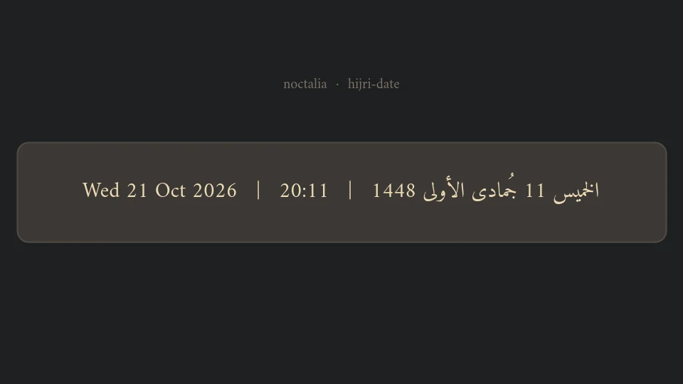

# Hijri Date

A Noctalia bar widget that shows the Gregorian date, the clock and the Hijri
date for a fixed location.



## Plugin

| Field | Value |
| --- | --- |
| ID | `hazembook/hijri-date` |
| Entries | Bar widget: `date-clock-hijri` |
| Data source | [aladhan.com](https://aladhan.com) v1 timings API |

## Usage

Add the `date-clock-hijri` widget from the Add-widget picker and place it on a
bar. It shows:

```
Wed 21 Oct 2026 | 05:32 PM | الاربعاء 10 جُمادى الأولى 1448
```

The Hijri day runs from **Maghrib to Maghrib**, so the date flips to the next
Hijri day once Maghrib has passed. Maghrib itself comes from the same API
response, and the comparison is done in minutes since midnight rather than by
comparing formatted strings.

Clicking the widget opens the shell's calendar panel.

A successful response is reused for an hour, since the Hijri date only changes
at Maghrib. A failed request backs off for five minutes instead of retrying on
every tick, and the previous day's values are dropped when the Gregorian date
rolls over, so a failed request can never leave a stale Hijri date on the bar.

The Hijri date, month name and weekday are shown exactly as the API spells them
(`الاربعاء`, `جُمادى الأولى`). The Hijri month length is taken from the API,
so the widget stays correct around month rollovers.

## Settings

All settings live on the widget itself (open the bar widget's settings):

| Setting | Type | Default | Description |
| --- | --- | --- | --- |
| `latitude` | `string` | `32.8872` | Latitude of the location used for prayer times and the Hijri date. |
| `longitude` | `string` | `13.1913` | Longitude of the location used for prayer times and the Hijri date. |
| `method` | `string` | `3` | Hijri calculation method (3 = Muslim World League, 4 = Umm al-Qura). |
| `clock_format` | `select` | `12h` | `12h` or `24h` clock. |

This plugin requires Noctalia plugin API 3, which keeps it installable on
every Noctalia v5 release.
